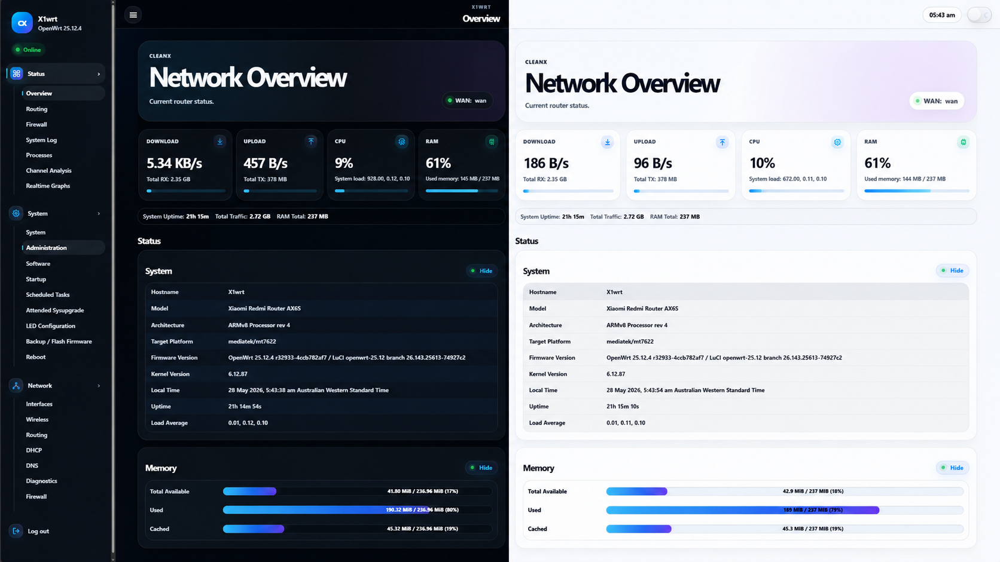
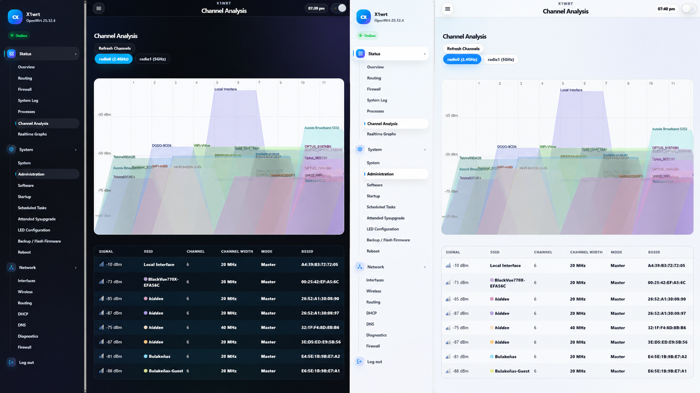
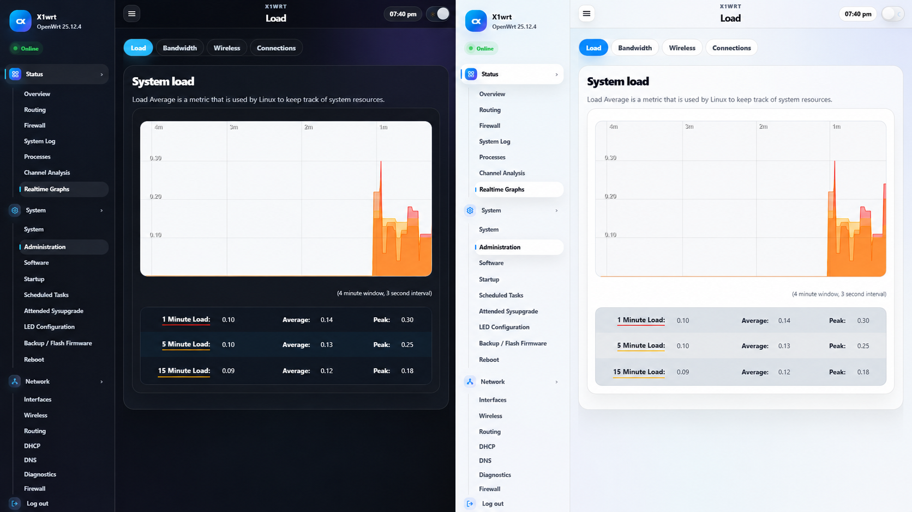

<p align="center">
  
</p>

<h1 align="center">CleanX</h1>

<p align="center">
  A clean, modern theme for the OpenWrt LuCI web interface —<br>
  dark and light modes, a responsive layout and a live router dashboard.
</p>

<p align="center">
  <a href="https://github.com/Ox1d3x3/cleanwrt-luci/releases/latest"></a>
  <a href="https://github.com/Ox1d3x3/cleanwrt-luci/actions/workflows/build-release.yml"></a>
  <a href="https://github.com/Ox1d3x3/cleanwrt-luci/releases"></a>
  
  <a href="LICENSE"></a>
</p>

---

<p align="center">
  
</p>

CleanX gives LuCI a calmer, easier-to-read interface without changing how
OpenWrt works. Every page, form and button keeps its native LuCI behaviour;
CleanX only restyles the layout and adds a small live dashboard on the
Overview page.

## Features

- **Dark and light modes** that follow your system setting, with a one-click toggle.
- **Responsive layout** — a sidebar with icons on desktop and a slide-out drawer on phones and tablets.
- **Live Overview dashboard** showing WAN download/upload speed, traffic totals, CPU, RAM and uptime.
- **Matching login page.**
- **Readable LuCI pages** — tidier cards, forms, tabs, tables, modals and action buttons across Status, Network, Wireless, Firewall, System, Software and more.
- **Lightweight** — pure CSS and JavaScript, no compiled code, no extra daemons. One architecture-independent package runs on every router CPU.

## Screenshots

| Channel analysis | Realtime graphs |
| --- | --- |
|  |  |

## Requirements

- OpenWrt **23.05 or newer** (CleanX uses the ucode-based LuCI theme system).
- `luci-base`, which every LuCI install already has.
- Any CPU architecture — the package is built as `all`.

## Installation

### One-line install

Run this on the router over SSH. It detects whether your firmware uses `opkg`
or `apk`, downloads the matching package from the latest release, installs it
and switches LuCI to CleanX:

```sh
wget -O- https://raw.githubusercontent.com/Ox1d3x3/cleanwrt-luci/main/scripts/install.sh | sh
```

To install a specific version, pass a tag: `wget -O- …/install.sh | TAG=v0.6.1 sh`.

### Manual install

Download the package for your firmware from the
[latest release](https://github.com/Ox1d3x3/cleanwrt-luci/releases/latest):

| Your firmware | Package manager | Download the file ending in |
| --- | --- | --- |
| OpenWrt 24.10 and older | `opkg` | `…-openwrt-24.10.6-universal.ipk` |
| OpenWrt 25.12 and newer | `apk` | `…-openwrt-25.12.4-universal.apk` |
| OpenWrt snapshot | `apk` | `…-openwrt-snapshot-universal.apk` |

Copy it to the router and install it (replace `192.168.1.1` with your router's address):

```sh
# opkg-based firmware
scp luci-theme-cleanx_*.ipk root@192.168.1.1:/tmp/
ssh root@192.168.1.1 'opkg install /tmp/luci-theme-cleanx_*.ipk'

# apk-based firmware
scp luci-theme-cleanx_*.apk root@192.168.1.1:/tmp/
ssh root@192.168.1.1 'apk add --allow-untrusted /tmp/luci-theme-cleanx_*.apk'
```

A fresh install selects CleanX automatically. Reload LuCI in your browser
(a hard refresh, <kbd>Ctrl</kbd>+<kbd>F5</kbd>, clears any cached styles).
Upgrades keep whichever theme you currently have selected.

You can also switch themes at any time under
**System → System → Language and Style → Design**.

## Configuration

Theme settings live in `/etc/config/cleanx` and are applied on the next page load:

| Option | Values | Default | Description |
| --- | --- | --- | --- |
| `mode` | `auto`, `light`, `dark` | `auto` | Default colour scheme. `auto` follows the browser/OS. The toggle in the top bar overrides this per browser. |
| `dashboard` | `1`, `0` | `1` | Show the live dashboard on Status → Overview. |
| `animations` | `balanced`, `full`, `off` | `balanced` | `off` disables all motion, `full` adds the drifting background. |

For example, to default to dark mode and turn animations off:

```sh
uci set cleanx.theme.mode='dark'
uci set cleanx.theme.animations='off'
uci commit cleanx
```

CleanX also respects the operating system's *reduce motion* setting.

## Uninstall and recovery

If a page ever looks broken, switch LuCI back to the default Bootstrap theme over SSH:

```sh
uci set luci.main.mediaurlbase='/luci-static/bootstrap'
uci commit luci
rm -rf /tmp/luci-indexcache /tmp/luci-modulecache
```

To remove CleanX completely, run
[`scripts/uninstall.sh`](scripts/uninstall.sh) on the router, or remove the
package yourself with `opkg remove luci-theme-cleanx` or
`apk del luci-theme-cleanx`.

> [!TIP]
> Keep SSH access available whenever you try a new LuCI theme or firmware
> build, so you can always recover from the command line.

## Building from source

Every push to `main` is built by
[GitHub Actions](.github/workflows/build-release.yml) with the official
OpenWrt SDKs, so you normally don't need to build anything yourself. To build
locally on Linux:

```sh
# Downloads the OpenWrt SDK and builds the package into ./dist
OPENWRT_VERSION=25.12.4 scripts/build-sdk.sh     # .apk
OPENWRT_VERSION=24.10.6 scripts/build-sdk.sh     # .ipk

# Or build inside an OpenWrt buildroot / SDK you already have
scripts/build-openwrt-package.sh /path/to/openwrt
```

You can also drop the repository into `package/` of an OpenWrt buildroot and
select **LuCI → Themes → luci-theme-cleanx** in `make menuconfig`.

Release builds minify the CSS automatically (Node.js required; the step is
skipped when it is not installed). The repository always keeps the readable source.

## Releases

Releases are fully automated:

- A push to `main` that changes the version publishes a **stable release** `vX.Y.Z` with
  `.ipk`/`.apk` packages, SHA256 checksums and notes taken from [`CHANGELOG.md`](CHANGELOG.md).
- Any other push to `main` that touches the theme or build files publishes a **pre-release** for testing
  (documentation-only changes don't trigger a build).

To cut a new release:

```sh
scripts/bump-version.sh 0.6.2   # updates every version string
# add a "## [0.6.2]" section to CHANGELOG.md
git commit -am "Release v0.6.2" && git push
```

## Project layout

```text
htdocs/luci-static/cleanx/        Stylesheets (main.css, login.css) and logo
htdocs/luci-static/resources/     menu-cleanx.js (layout, navigation) and cleanx-dashboard.js
ucode/template/themes/cleanx/     LuCI page templates: header, footer, login
root/etc/uci-defaults/            First-boot / install script that registers the theme
root/usr/share/rpcd/acl.d/        Read-only permissions for the dashboard
preview/                          Static mock pages for checking styles in a browser
scripts/                          Install, uninstall, build and version tools
```

## Development

Open [`preview/index.html`](preview/index.html) in a browser to see the theme on
static mock pages; [`preview/compat/`](preview/compat/index.html) contains mocks
of the more complex LuCI pages. Both load the stylesheet straight from
`htdocs/`, so edits show up on reload.

LuCI pages vary a lot depending on the installed packages, so before sending a
change, check desktop and mobile widths on at least:

- Status → Overview, Realtime Graphs and Channel Analysis
- Network → Interfaces (including the Devices tab), Wireless and DHCP/DNS
- Network → Firewall → Zones and Traffic Rules
- System → System, Startup, Processes and LED Configuration
- System → Software / Package Manager, including its install dialogs
- System → Backup / Flash Firmware

Issues and pull requests are welcome.

## License

CleanX is released under the [Apache License 2.0](LICENSE).

Created and maintained by [@Ox1d3x3](https://github.com/Ox1d3x3). If CleanX is
useful to you, a ⭐ on the repository helps other OpenWrt users find it.
