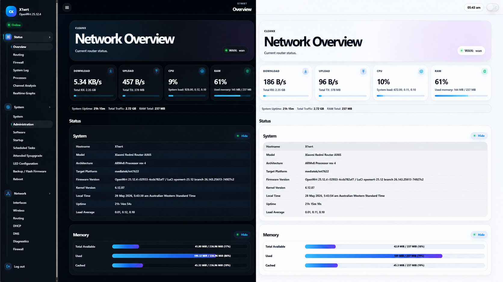
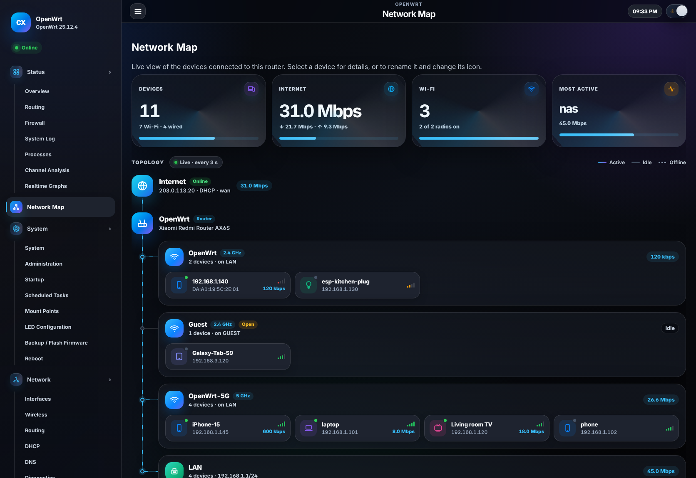
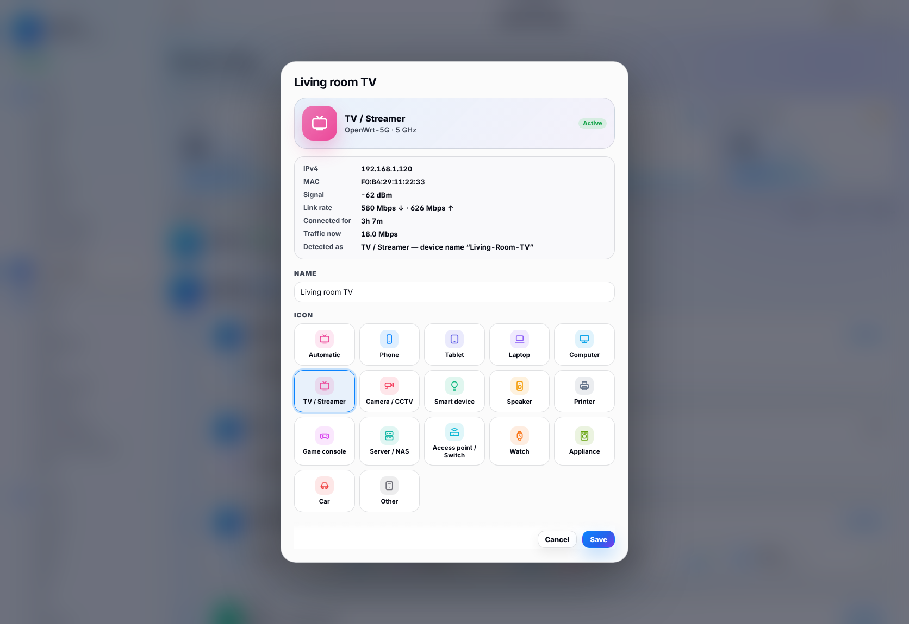
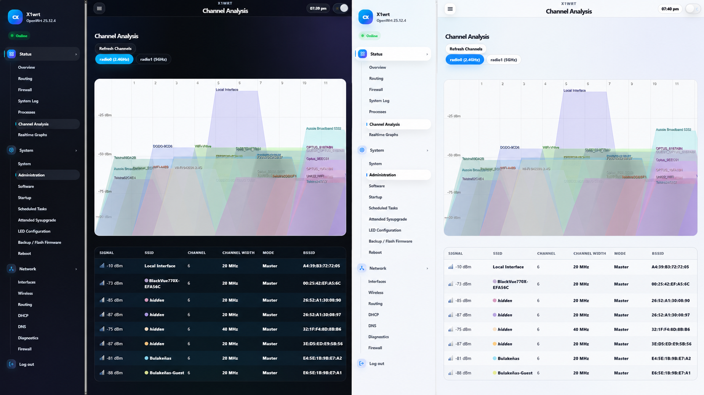
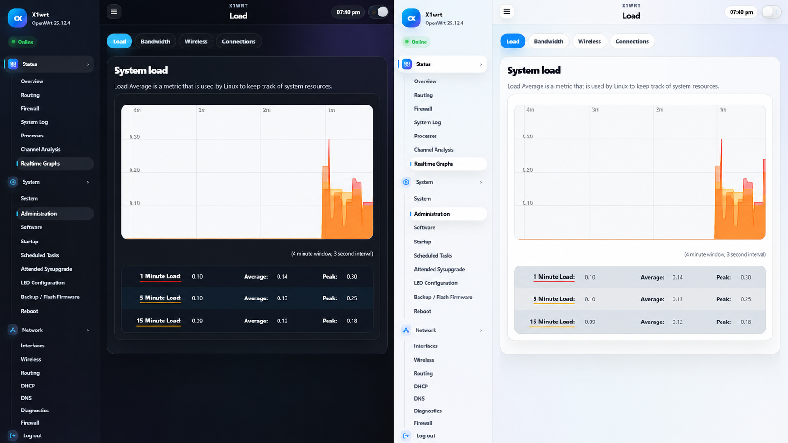

<p align="center">
  
</p>

<h1 align="center">CleanX</h1>

<p align="center">
  A clean, modern theme for the OpenWrt LuCI web interface —<br>
  dark and light modes, a responsive layout, a live router dashboard and a network map.
</p>

<p align="center">
  <a href="https://github.com/Ox1d3x3/cleanwrt-luci/releases/latest"></a>
  <a href="https://github.com/Ox1d3x3/cleanwrt-luci/actions/workflows/build-release.yml"></a>
  <a href="https://github.com/Ox1d3x3/cleanwrt-luci/releases"></a>
  
  <a href="LICENSE"></a>
</p>

---

<p align="center">
  
</p>

CleanX gives LuCI a calmer, easier-to-read interface without changing how
OpenWrt works. Every page, form and button keeps its native LuCI behaviour;
CleanX restyles the layout and adds two things of its own: a live dashboard on
the Overview page and a Network Map of everything connected to your router.

## Quick install

Connect to your router over SSH and paste this one line:

```sh
wget -O /tmp/cleanx-apply.sh https://github.com/Ox1d3x3/cleanwrt-luci/releases/latest/download/cleanx-apply.sh && sh /tmp/cleanx-apply.sh
```

Then reload LuCI in your browser with <kbd>Ctrl</kbd>+<kbd>Shift</kbd>+<kbd>R</kbd>
(<kbd>Cmd</kbd>+<kbd>Shift</kbd>+<kbd>R</kbd> on macOS). That's it.

This is the recommended **standalone install**: it works on OpenWrt 23.05, 24.10,
25.12 and snapshots on any router, keeps
[Attended Sysupgrade](#why-standalone) working, and CleanX stays installed after
firmware upgrades. Run the same command again whenever you want to update.
See [Installation](#installation) for step-by-step instructions and other options.

## Features

- **Dark and light modes** that follow your system setting, with a one-click toggle.
- **Responsive layout** — a sidebar with icons on desktop and a slide-out drawer on phones and tablets.
- **Live Overview dashboard** showing WAN download/upload speed, traffic totals, CPU, RAM and uptime.
- **Network Map** — every device on your Wi-Fi and LAN, live, with type icons, signal, speed and the LAN port it is plugged into. Rename devices and pick their icons. [More below](#network-map).
- **Matching login page.**
- **Readable LuCI pages** — tidier cards, forms, tabs, tables, modals and action buttons across Status, Network, Wireless, Firewall, System, Software and more.
- **Upgrade-friendly** — the standalone install keeps Attended Sysupgrade working and survives firmware upgrades with your settings.
- **Lightweight** — pure CSS and JavaScript, no compiled code, no extra daemons. Runs on every router CPU.

## Screenshots

| Network Map | Device details |
| --- | --- |
|  |  |

| Channel analysis | Realtime graphs |
| --- | --- |
|  |  |

## Network Map

Open **Network Map** in the sidebar for a live view of your network:
Internet → your router → each Wi-Fi network and wired network → the devices on it.

- **Live traffic.** Links light up and move while data flows, faster with more
  traffic; quiet links rest and offline ones are dashed. Summary cards show the
  number of devices, your Internet speed (download and upload), your Wi-Fi
  networks and the busiest device right now.
- **Every device at a glance** — its type icon, IP address, Wi-Fi signal and
  current speed. Wired devices show the LAN port they are plugged into.
- **Device details.** Select a device to see its IPv4/IPv6 and MAC addresses,
  signal, link rate, how long it has been connected and why it was detected as
  that type, and to **rename it or pick a different icon**. Names and icons are
  saved on the router in `/etc/config/cleanx`, so they are kept across firmware
  upgrades and show up in every browser. Names you gave devices in UniWRT's map
  are picked up too.
- **Automatic device types** from the device's name, the maker of its network
  card, and private (randomised) Wi-Fi addresses, which are typical of phones.
  With the optional `ufpd` fingerprinting service installed, its results are used as well.
- **Access points.** If your OpenWrt device is an access point behind another
  router, the map shows the main router at the top and marks the LAN port it is
  connected to. Devices that get their address from the main router are still
  listed.

The map is light on the router: it asks for data LuCI's own Status pages use
(DHCP leases, the neighbour table, the Wi-Fi station list and interface
counters) in one request per refresh, and only while the page is open in a
visible browser tab. Everything else happens in your browser. It refreshes every
5 seconds; change that with `netmap_interval` (see [Configuration](#configuration)).
No data is sent anywhere outside your network.

## Requirements

- OpenWrt **23.05 or newer** (CleanX uses the ucode-based LuCI theme system).
- `luci-base`, which every LuCI install already has.
- Any CPU architecture — the package is built as `all`.

## Installation

There are two ways to install CleanX. Both install exactly the same files; the
difference is whether the theme is registered with the package manager, which
decides whether OpenWrt firmware upgrades keep working.

| | **Standalone (recommended)** | Package (`.ipk` / `.apk`) |
| --- | --- | --- |
| Attended Sysupgrade (LuCI *Firmware Upgrade* page, `owut`) | ✅ Works | ❌ Fails while the theme is installed |
| After a firmware upgrade with *Keep settings* | ✅ CleanX and your settings are still there | ❌ Theme is gone and must be reinstalled |
| Install and update | One command | Download the right file and install it by hand |
| Uninstall | `sh /tmp/cleanx-apply.sh --uninstall` | `apk del` / `opkg remove` |

### Standalone install (recommended)

**1. Connect to the router.** Open a terminal — *Terminal* on macOS and Linux,
*PowerShell* or *Windows Terminal* on Windows 10/11 — and log in, replacing
`192.168.1.1` with your router's address:

```sh
ssh root@192.168.1.1
```

**2. Install CleanX.** Paste this and press <kbd>Enter</kbd>:

```sh
wget -O /tmp/cleanx-apply.sh https://github.com/Ox1d3x3/cleanwrt-luci/releases/latest/download/cleanx-apply.sh && sh /tmp/cleanx-apply.sh
```

The script downloads the latest release, checks it against the release's
`SHA256SUMS`, makes sure there is enough free space, installs the theme and
switches LuCI to CleanX.

**3. Reload LuCI** in your browser with a hard refresh
(<kbd>Ctrl</kbd>+<kbd>Shift</kbd>+<kbd>R</kbd>, or <kbd>Cmd</kbd>+<kbd>Shift</kbd>+<kbd>R</kbd> on macOS).

**To update later**, run the same command from step 2 again. Your settings and
theme choice are kept.

**Already have the CleanX package installed?** Run the same command. It removes
the package, installs the standalone copy and keeps your settings and theme
choice, so firmware upgrades start working again.

Once the script is on the router, it can also do the following:

| Command | What it does |
| --- | --- |
| `sh /tmp/cleanx-apply.sh` | Install, or update to the latest release |
| `sh /tmp/cleanx-apply.sh --status` | Show the installed version and how it is installed, and check every file is present |
| `sh /tmp/cleanx-apply.sh --version v0.6.2` | Install a specific release |
| `sh /tmp/cleanx-apply.sh --file /tmp/luci-theme-cleanx-standalone.tar.gz` | Install from a downloaded archive ([no internet on the router](#no-internet-on-the-router)) |
| `sh /tmp/cleanx-apply.sh --uninstall` | Remove CleanX and switch LuCI back to Bootstrap |
| `sh /tmp/cleanx-apply.sh --package` | Install the regular `.ipk` / `.apk` package instead |

<a name="why-standalone"></a>
<details>
<summary><b>Why standalone? How does it work?</b></summary>
<br>

OpenWrt's [Attended Sysupgrade](https://openwrt.org/docs/guide-user/installation/attended.sysupgrade)
builds your new firmware from the list of installed **packages**. OpenWrt's
build servers only know packages from the official feeds, so a theme installed
from a downloaded package makes the upgrade fail with
*"Impossible package selection"*.

The standalone install copies the theme's files into place without registering
a package, so the upgrade request never mentions CleanX. It lists every file in
`/lib/upgrade/keep.d/cleanx-standalone`, OpenWrt's standard list of extra files
to keep, so `sysupgrade` carries the theme and your settings into the new
firmware whenever *Keep settings* is enabled. The archive is cut from the same
build as the `.ipk`, so the files are byte-identical to the package.
</details>

#### No internet on the router?

1. On your computer, download `cleanx-apply.sh`, `luci-theme-cleanx-standalone.tar.gz`
   and `SHA256SUMS` from the [latest release](https://github.com/Ox1d3x3/cleanwrt-luci/releases/latest).
2. Copy them to the router:
   ```sh
   scp cleanx-apply.sh luci-theme-cleanx-standalone.tar.gz SHA256SUMS root@192.168.1.1:/tmp/
   ```
   If `scp` reports `sftp-server: not found`, add `-O` after `scp`.
3. On the router, run:
   ```sh
   sh /tmp/cleanx-apply.sh --file /tmp/luci-theme-cleanx-standalone.tar.gz
   ```

#### Download failing?

The router needs working internet access and the correct date and time (HTTPS
certificates are checked against the clock). Run `date` to check it. If it's
wrong, enable NTP under **System → System → Time Synchronization** and try
again, or use the [offline install](#no-internet-on-the-router).

### Package install

Only use the package if you don't use Attended Sysupgrade and are happy to
reinstall the theme after every firmware upgrade.

<details>
<summary>Show package install instructions</summary>
<br>

The easiest way is `sh /tmp/cleanx-apply.sh --package`, which picks the right
package for your firmware. To do it by hand, download the package from the
[latest release](https://github.com/Ox1d3x3/cleanwrt-luci/releases/latest),
copy it to `/tmp` on the router and install it:

| Your firmware | Package manager | Download the file ending in |
| --- | --- | --- |
| OpenWrt 23.05 / 24.10 | `opkg` | `…-openwrt-24.10.6-universal.ipk` |
| OpenWrt 25.12 and newer | `apk` | `…-openwrt-25.12.4-universal.apk` |
| OpenWrt snapshot | `apk` | `…-openwrt-snapshot-universal.apk` |

```sh
opkg install /tmp/luci-theme-cleanx_*.ipk                  # OpenWrt 23.05 / 24.10
apk add --allow-untrusted /tmp/luci-theme-cleanx_*.apk     # OpenWrt 25.12 and newer
```

Not sure which you have? Run `command -v apk` on the router: if it prints a
path, use the `.apk`. `--allow-untrusted` is needed because the package comes
from GitHub rather than a signed OpenWrt feed.

To switch to the standalone install later, run the
[standalone install](#standalone-install-recommended) command. Your settings are kept.
</details>

### Selecting the theme

A fresh install switches LuCI to CleanX automatically; updates never override a
theme you have chosen since. You can switch themes at any time under
**System → System → Language and Style → Design**, or with:

```sh
uci set luci.main.mediaurlbase='/luci-static/cleanx'
uci commit luci
```

## Configuration

Theme settings live in `/etc/config/cleanx` and are applied on the next page load:

| Option | Values | Default | Description |
| --- | --- | --- | --- |
| `mode` | `auto`, `light`, `dark` | `auto` | Default colour scheme. `auto` follows the browser/OS. The toggle in the top bar overrides this per browser. |
| `dashboard` | `1`, `0` | `1` | Show the live dashboard on Status → Overview. |
| `animations` | `balanced`, `full`, `off` | `balanced` | `balanced`: hover effects, and icon animations that play briefly after a page loads. `full`: icon animations loop continuously and the background drifts (needs a fast GPU). `off`: no motion (the Network Map then shows busy links highlighted but still). |
| `netmap_interval` | `3` – `60` | `5` | Seconds between Network Map refreshes while the page is open. |

For example, to default to dark mode and turn animations off:

```sh
uci set cleanx.theme.mode='dark'
uci set cleanx.theme.animations='off'
uci commit cleanx
```

CleanX also respects the operating system's *reduce motion* setting.

## Uninstall and recovery

If a page ever looks broken, switch LuCI back to the default Bootstrap theme over SSH:

```sh
uci set luci.main.mediaurlbase='/luci-static/bootstrap'
uci commit luci
rm -rf /tmp/luci-indexcache /tmp/luci-modulecache
```

To remove CleanX completely:

```sh
sh /tmp/cleanx-apply.sh --uninstall                 # standalone install (the default)
apk del luci-theme-cleanx                           # package install, OpenWrt 25.12+
opkg remove luci-theme-cleanx                       # package install, OpenWrt 23.05 / 24.10
```

If `/tmp/cleanx-apply.sh` is gone (for example after a reboot), download it again
with the first half of the [install command](#quick-install), or use
[`scripts/uninstall.sh`](scripts/uninstall.sh), which handles both kinds of install.

> [!TIP]
> Keep SSH access available whenever you try a new LuCI theme or firmware
> build, so you can always recover from the command line.

## Building from source

Every push to `main` is built by
[GitHub Actions](.github/workflows/build-release.yml) with the official
OpenWrt SDKs, so you normally don't need to build anything yourself. To build
locally on Linux:

```sh
# Downloads the OpenWrt SDK and builds the package into ./dist
OPENWRT_VERSION=25.12.4 scripts/build-sdk.sh     # .apk
OPENWRT_VERSION=24.10.6 scripts/build-sdk.sh     # .ipk

# Or build inside an OpenWrt buildroot / SDK you already have
scripts/build-openwrt-package.sh /path/to/openwrt
```

You can also drop the repository into `package/` of an OpenWrt buildroot and
select **LuCI → Themes → luci-theme-cleanx** in `make menuconfig`.

Release builds minify the CSS automatically (Node.js required; the step is
skipped when it is not installed). The repository always keeps the readable source.

## Releases

Releases are fully automated. Each one contains the standalone archive,
`cleanx-apply.sh`, the `.ipk`/`.apk` packages and a `SHA256SUMS` file.

- A push to `main` that changes the version publishes a **stable release** `vX.Y.Z`
  with notes taken from [`CHANGELOG.md`](CHANGELOG.md).
- Any other push to `main` that touches the theme or build files publishes a
  **pre-release** for testing (documentation-only changes don't trigger a build).

Before publishing, CI runs two test suites:

- **Installer** ([`tests/`](tests/)): installs the standalone archive into a
  simulated router with OpenWrt's own BusyBox, `uci` and `apk`, runs a
  simulated firmware upgrade, and migrates a real `.apk` install to standalone.
- **UI interaction audit** ([`tests/ui/`](tests/ui/)): renders every LuCI page
  of OpenWrt 24.10 and 25.12 with the real LuCI templates and JavaScript, then
  clicks through every tab, Edit/Add dialog, checkbox, select, text field and
  dropdown with a real mouse — once with CleanX and once with stock LuCI
  (Bootstrap). The release is blocked if anything works with Bootstrap but not
  with CleanX, or if CleanX shows something LuCI hides. The same job checks the
  Network Map on desktop and phone, in light and dark mode and in access-point
  mode, including renaming a device.

To cut a new release:

```sh
scripts/bump-version.sh 0.6.4   # updates every version string
# add a "## [0.6.4]" section to CHANGELOG.md
git commit -am "Release v0.6.4" && git push
```

## Project layout

```text
htdocs/luci-static/cleanx/        Stylesheets (main.css, login.css) and logo
htdocs/luci-static/resources/     menu-cleanx.js (layout, navigation) and cleanx-dashboard.js
htdocs/luci-static/resources/view/cleanx/netmap.js   The Network Map page
ucode/template/themes/cleanx/     LuCI page templates: header, footer, login
root/etc/config/cleanx            Default theme settings
root/etc/uci-defaults/            Registers the theme on package installs
root/usr/share/luci/menu.d/       Adds Network Map to the LuCI menu
root/usr/share/rpcd/acl.d/        Permissions for the dashboard and Network Map
preview/                          Static mock pages for checking styles in a browser
cleanx-apply.sh                   Standalone installer / updater / uninstaller (runs on the router)
scripts/                          Build, archive and version tools
tests/                            Installer tests against a simulated OpenWrt root
tests/ui/                         UI interaction audit against stock LuCI (see Development)
```

## Development

Open [`preview/index.html`](preview/index.html) in a browser to see the theme on
static mock pages; [`preview/compat/`](preview/compat/index.html) contains mocks
of the more complex LuCI pages. Both load the stylesheet straight from
`htdocs/`, so edits show up on reload.

To run the same UI interaction audit as CI (needs Node.js, Python 3, git,
cmake and the json-c headers):

```sh
cd tests/ui && npm install && npx playwright install chromium && cd ../..
tests/ui/run.sh openwrt-25.12                      # or openwrt-24.10
tests/ui/run.sh openwrt-25.12 390x844              # phone-sized viewport
tests/ui/run.sh openwrt-25.12 1440x900 'firewall'  # only matching pages
```

It prints a report of any control that is covered, hidden, can't be selected
or behaves differently from stock LuCI. LuCI pages also vary with the installed
packages, so it is still worth checking desktop and mobile widths by hand on at
least:

- Status → Overview, Realtime Graphs and Channel Analysis
- Network Map, including a device's details dialog
- Network → Interfaces (including the Devices tab), Wireless and DHCP/DNS
- Network → Firewall → Zones and Traffic Rules
- System → System, Startup, Processes and LED Configuration
- System → Software / Package Manager, including its install dialogs
- System → Backup / Flash Firmware

Issues and pull requests are welcome.

## License

CleanX is released under the [Apache License 2.0](LICENSE).

Created and maintained by [@Ox1d3x3](https://github.com/Ox1d3x3). If CleanX is
useful to you, a ⭐ on the repository helps other OpenWrt users find it.
